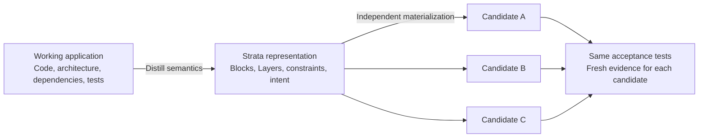

# Strata

**Source control for application intent**

**Many agents. Shared intent. Clear ownership.**

**Developer preview.** Self-hosted and attended; no hosted Studio account service is provided.

**Start here:** [Getting started](docs/GETTING_STARTED.md) · [Implemented contract](docs/IMPLEMENTED_CONTRACT.md) · [Development and checks](CONTRIBUTING.md).

Installation and current scope: [Self-hosting](docs/studio/SELF_HOSTING.md) · [Studio status](docs/studio/STATUS.md) · [Roadmap](docs/ROADMAP.md).

[Public distribution](docs/PUBLIC_DISTRIBUTION.md) describes the sanitized snapshot and private-history boundary.

Strata is licensed under [Apache 2.0](LICENSE), with [third-party notices](THIRD_PARTY_NOTICES.md).

Strata is a source control prototype for software built by people and agents. Powered by **Cloudflare Workers and the Agents SDK**, it versions what an application must do: its behavior, constraints, relationships, and acceptance criteria. People and agents propose changes in owned Layers, compose them into a candidate, and carry reviewed decisions and implementation evidence into a Release.

**The code can change. What you learned should carry forward.** Strata gives the reasoning behind a product a durable home alongside its requirements. The ambition is to make reviewed intent the source of truth, so a new team, model, or toolchain can build on the same product knowledge and produce a fresh, tested implementation.

[Strata Studio](docs/studio/STATUS.md) combines exact intent browsing with explicitly configured creation, changes and review. The [read-only default](docs/explorer/README.md) preserves existing source access boundaries.

The [local Git adoption workflow](docs/NATIVE_GIT_ADOPTION.md) stages supplied patches against an exact accepted source binding, records application evidence and code review, and explicitly applies reviewed files. Finalization follows an owner-created commit; the adapter makes no commits or pushes.

[Authoritative local revalidation](docs/REVALIDATION_R1_C.md) completes an exact approved v0.1 revalidate plan through an explicitly granted named account and the bounded recognized counter producer. It preserves accepted intent and source binding; historical fixture evidence remains unauthenticated.

[Git and Strata coexistence](docs/GIT_COEXISTENCE.md) covers new/existing project setup, metadata placement, command analogies and ignore rules that preserve durable intent.

[Cloudflare architecture](#cloudflare-architecture) · [The idea](#a-new-unit-of-source-control) · [The model](#the-model) · [Agent workflow](#built-for-agent-development) · [Quick start](#quick-start) · [Developer preview](#developer-preview) · [Explore the repository](#explore-the-repository)

## Cloudflare architecture

Strata maps its collaboration model onto Cloudflare's stateful runtime: individual Layer services prepare proposals, a project service coordinates publication, and immutable artifacts preserve the records behind each decision.

| Component | Role in Strata | Available today |
| --- | --- | --- |
| [Workers](https://developers.cloudflare.com/workers/) | Runtime for the TypeScript broker and its operation API. | Local execution through Wrangler and workerd. |
| [Agents SDK](https://developers.cloudflare.com/agents/) + [Durable Objects](https://developers.cloudflare.com/durable-objects/) | `LayerAgent` prepares owned proposals; `ProjectAgent` maintains the publication registry. Artifact storage is sharded across local Durable Objects. | Implemented in [`src/worker.ts`](src/worker.ts), with SQLite state and recorded local SDK checks. |
| [Artifacts](https://developers.cloudflare.com/artifacts/) | Git-compatible, versioned storage for the remote artifact adapter. | Immutable trees, exact commit-qualified reads and integrity checks through an explicitly configured host. |
| [Workflows](https://developers.cloudflare.com/workflows/) | Durable coordination for optional integration examples. | Bounded execution, exact decision packets and explicit activation gates. |

The everyday SDK broker uses local Durable Object storage. A Node broker provides a second runtime for local iteration on the core semantics. [Storage integration](docs/ARTIFACTS_REGISTRY_INTEGRATION.md) describes the adapter contract. Remote operation requires host configuration; production hosted identity remains follow-on work.

## A new unit of source control

Git made code history a shared foundation for software development. Strata explores the next abstraction: **version the application's intent, then realize it as code**.

Choosing the right feature, understanding a customer, and learning why a constraint matters are lasting engineering investments. Strata captures those decisions in structured contracts that can be reviewed, composed, and checked. A Release preserves the accepted behavior, its provenance, and the evidence behind it. A later implementation can be evaluated against that same intent.

This changes the unit of collaboration. An agent contributes a proposal such as “increase the supported capacity,” complete with its baseline, dependencies, assumptions, and acceptance criteria. The team can review how that proposal interacts with a dependent rule before realizing the combined candidate through a supported implementation profile.

A useful mental model is **semantic compression**: preserve the intended behavior, constraints, and reviewed decisions rather than identical source bytes. Application intent is the durable asset; implementations can evolve. Consistent independent reconstruction is the ambition and test criterion: can different agents materialize working implementations that pass the **same acceptance tests**? Every new realization needs fresh evidence. This is not a lossless encoding, a guarantee of equivalence, or a proven universal regeneration capability.



*Target model. The three outputs are candidates, not recorded successes. Today, distillation accepts prepared proposals and materialization uses finite declared profiles.*

The illustrative conflict explorer in [the separate marketing site](https://github.com/mendipan/strata-site) explains the proposed interaction: a $15 coupon on a $60 checkout leaves $45, while free shipping starts at $50. One Layer uses the discounted subtotal; another uses the original. Both contributions stay visible, the shipping rule needs a decision, and the preview is blocked until resolution. The two policies yield $52 or $45. Resolving a candidate is separate from validating it; the website button only simulates that gate. The marketing repository owns that simulation and its SVG illustrations; its README explains local preview and checks.

The source-control core operates on declared capabilities. Finite example profiles exercise composition, validation and Release with different topology and requirements. [Profile separation](docs/PROFILE_SEPARATION.md) documents their boundary and limits. This does not provide arbitrary application synthesis.

## The model

Five objects connect a product decision to a reviewed baseline:

| Object | What it represents |
| --- | --- |
| **Block** | Bounded application intent with stable identity, requirements, relationships and acceptance criteria. |
| **Layer** | One owner's revisioned proposal against an exact baseline. Published revisions are immutable. |
| **Composition** | A candidate pinning its baseline, considered and selected Layer revisions, scenario and Resolutions. |
| **Resolution** | An authorized decision bound to the exact proposals and interaction under review. |
| **Release** | An approved semantic snapshot preserving validated intent, evidence and provenance. |

The development loop is explicit:

1. **Read** a pinned Release and the relevant Blocks.
2. **Propose** changes in owned Layers, declaring exact dependencies and assumptions.
3. **Compose and decide** which proposals belong together, recording the required Resolutions.
4. **Materialize and check** the candidate through a supported profile, collecting fresh evidence from the resulting implementation.
5. **Approve and release** the exact candidate, preserving its intent and history for the next iteration.

An **implementation profile** connects supported intent to a concrete recipe for code and validation. This makes the relationship between a requirement, its implementation, and its evidence inspectable. Feedback from the working application returns through another reviewed Layer.

Blocks use structured JSON. The default v0.1 contract has seven fields; the opt-in v0.2 contract adds `description` and `asset_refs`. See the [Block contract](docs/BLOCK_CONTRACT.md) for schemas and examples, and the [semantic model](STRATA_MODEL.md) for the full design.

## Built for agent development

Strata gives coding agents a shared protocol for contributing to a product:

- **Clear ownership.** Each author changes its own Layer and can inspect published peer proposals within its project access.
- **Precise context.** Baselines, peer dependencies, and considered proposals use exact revisions. Assumptions are checked against the combined candidate.
- **Visible decisions.** Competing proposals stay available for review; explicit selections record what was accepted and why.
- **Evidence attached to the work.** Implementation output, acceptance results, and required approvals bind to the candidate being released.
- **A reusable handover.** The next task starts from a Release that carries the effective intent and provenance forward.

Your existing agent framework runs the work. Strata defines how those contributions become a reviewed baseline. The CLI exposes structured JSON, stable exit codes, dry runs, and readable `--human` output for developers following along.

Use `doctor --offline` for local configuration diagnostics and `review layer|validation|authoring-review EXACT_REF` to distinguish assertions, imported check outcomes and unverified scope. Both offer human and JSON output; [review and diagnostics](docs/CLI_REVIEW_DOCTOR.md) describes their checks and limits.

Start an integration with the [portable agent skill](agent/strata/SKILL.md) and [complete CLI session example](examples/agent-session.json). The host supplies the agent's assignment, exact starting references, and permissions; the skill explains how to inspect intent, publish an owned proposal, and hand off decisions and approvals.

## Quick start

Requires **Node.js 22+**. From the repository root:

```powershell
npm ci --ignore-scripts --no-audit --no-fund
npm run build
node dist/src/cli.js doctor --offline --json
npm run demo
```

The deterministic demo uses local fixture sessions and a Node broker to propose, compose, realize, check and release an example. It makes no model or cloud calls. Outputs stay under ignored `.strata/` directories.

Open the synthetic Studio sample with `node dist/scripts/studio.js --sample --port 0`. Use the complete launch link printed in the terminal and keep the terminal open while browsing.

See [getting started](docs/GETTING_STARTED.md) for offline installation, runtime choices and troubleshooting, and [local verification](docs/VERIFICATION.md) for repeatable checks.

## Developer preview

Strata implements exact-reference composition, owned proposals, finite materialization profiles, candidate-bound evidence and explicit Release approvals. The [implemented contract](docs/IMPLEMENTED_CONTRACT.md) defines the supported subset; the [semantic model](STRATA_MODEL.md) also contains future design.

The `distill` return path accepts a person- or agent-prepared proposal. An explicit source manifest and per-change traceability connect implementation feedback to an owned draft for exact review. It performs no automatic semantic extraction. See [bidirectional translation](translation/README.md) for the full loop and its regression checks.

Local demo identities and attestations are fixtures. Self-hosted Studio has explicit browser-owner and named-account contracts; these do not authenticate demo identities. Native Codex 0.162.1 has demonstrated a real proposal saved privately and bounded recovery/Stop; instrumented runtime and packaged identity were checked separately. Complete integrated Profile → Build is post-launch work. Independent evidence across arbitrary backends and general reconstruction remain open. Every realization needs fresh evidence; a Release is not deployment.

## Explore the repository

| Path | Purpose |
| --- | --- |
| [Semantic model](STRATA_MODEL.md) | Design commitments and semantic rules. |
| [Implemented contract](docs/IMPLEMENTED_CONTRACT.md) | Current capabilities and limits. |
| [Block contract](docs/BLOCK_CONTRACT.md) | Versioned JSON shape and validation. |
| [Profile separation](docs/PROFILE_SEPARATION.md) | Core and finite implementation profiles. |
| [Bidirectional translation](translation/README.md) | Source traces, draft review and fresh evidence. |
| [Strata Studio](docs/studio/STATUS.md) | Creation/change/review workflow, CLI parity and read-only default. |
| [Examples](examples/README.md) | Isolated fixtures and local walkthroughs. |
| [Marketing site](https://github.com/mendipan/strata-site) | Separate static website repository; Studio and engine code stay here. |
| [Contributing](CONTRIBUTING.md) | Setup, checks and repository boundaries. |
