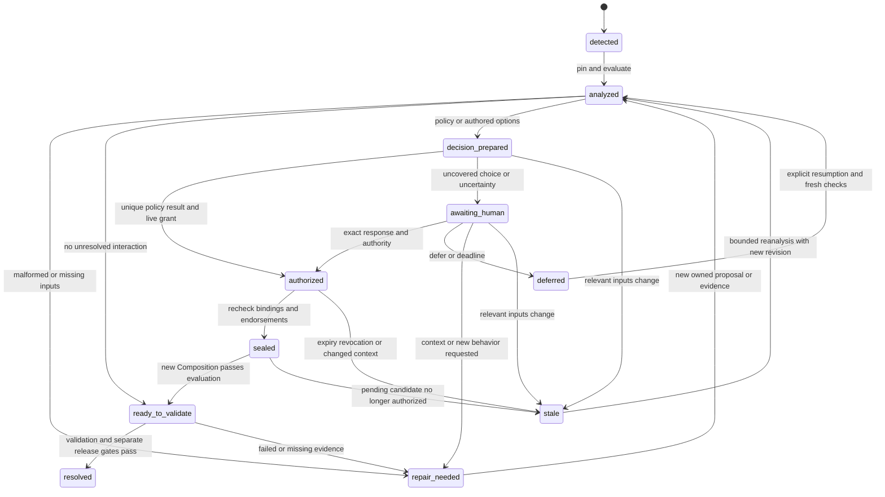

# Mediation and conflict resolution plan

Checkpoint note, 2026-10-04: Historical design proposal, preserved before implementation. The subsequently approved minimal prerequisite and [S2](MEDIATION_SLICE2.md) implement one fixed local booking policy, exact human packets, durable fixture uses and report carry-forward. Broader policy languages, model mediation and hosted authority remain deferred. The original examples and future interfaces below are not grants or a claim that the whole plan is implemented.

Status: mediation design. [The bounded implementation](MEDIATION_SLICE2.md) documents the delivered local subset; generalized policies and hosted authority remain proposals.

## Recommendation and responsibility boundary

**A mediator is a role, not necessarily another agent.** The existing lead agent can prepare recommendations; the host can assign a separate agent when an independent review is useful. Neither is required for routine deterministic resolution. Strata should supply a small mediation contract around its existing checks, authored decision Layers, authorization, and Resolution sealing. The existing host supplies reasoning, task assignment, human interaction, execution, and budgets.

Upfront guidelines remove repeated decisions when they specify an objectively checkable situation, a unique permitted outcome, and the authority delegated to take it. An optional model can explain conflicts, identify omissions, and propose alternatives. Its interpretation, confidence, or recommendation cannot establish permission, behavioral evidence, or a policy exception. It never adopts an operator identity or edits another actor's Layer.

Aim to resolve **recurring, well-specified conflicts** automatically and present genuine choices as planning decisions that can be answered once. There is no evidence that most Strata conflicts currently fall into that category. Measure the eligible and actually resolved shares before promising a percentage. Structural coalescing, policy-authorized selection, human choice, and unresolved cases are distinct outcomes.

| Responsibility | Strata source-control engine | Existing host / orchestrator |
| --- | --- | --- |
| Detect and describe | Exact collisions, dependencies/assumptions, known constraints, attributed interaction reports, impact and authority routing. | Optional semantic review, discovery of undeclared dependencies, domain context gathering. |
| Propose | Validate and preserve owned behavioral and decision-only Layers, exact inputs, alternatives and provenance. | Assign an authorized author, optionally ask a model to recommend or draft, obtain missing context. |
| Authorize | Check operation grants, baseline authority, exact policy delegation and endorsements; seal only permitted decisions. | Supply an existing identity through the authorized channel; prompts do not grant credentials. |
| Ask a person | Produce immutable decision packets and validate bound responses. | Render chat, terminal or other UI; route to the responsible authority, wait, cancel and remind within existing permissions. |
| Validate and publish | Require bound evidence and scope/guardian/release endorsements; preserve complete Releases. | Run approved checks/models within separately authorized execution and cost limits. |

Do not add a resident mediator service, multi-agent scheduler, negotiation swarm, identity provider, enterprise approval hierarchy, or general policy language. Current Cloudflare `LayerAgent` and `ProjectAgent` are runtime components, not an LLM mediator. Runtime concurrency research and `AGENT_CONCURRENCY_RESEARCH.md` belong to the separate research task and are neither duplicated nor prerequisites.

## Established, implemented, and missing

Sources were read locally. Source establishes implemented behavior; the canonical model establishes intended semantics and labels its own proposed defaults; plans do not establish implementation.

| Status | Grounding and consequence |
| --- | --- |
| **Established model direction** | [STRATA_MODEL.md §§2, 4-7](../STRATA_MODEL.md): immutable owned Layers; complete considered sets; whole-Layer selection; no ordering precedence; baseline authority and additional guardians; no invented behavior inside a Resolution; exact evidence and approvals. |
| **Implemented, local fixture only** | [core.ts](../src/core.ts), `normalizeLayer`, `contextFingerprint`, `Engine.evaluate`, `resolution`, `approve`, `validate`, `release`: decision-only Layers, authorized `select` outcomes, complete selected/rejected partitions, conservative pinning, bounded booking checks and separate release gates. A separately authored replacement can be selected; a Resolution cannot synthesize it. |
| **Implemented authorization** | [security.ts](../src/security.ts), `FixtureIssuer`, and [service.ts](../src/service.ts), `executeAuthorized`: operation allowlists, owner/configured task bounds, project binding, current fixture-policy checks, endorsement liveness, separate author/preparer/reviewer/evidence/selector/guardian/release assignments. These are impersonable local fixtures, not hosted authentication or production delegation. |
| **Implemented operational surface** | [cli.ts](../src/cli.ts): JSON envelopes, dry runs, exact refs, human-readable output, capability discovery and fixed exits. [publication.ts](../src/publication.ts), [local-broker.ts](../src/local-broker.ts), and [worker.ts](../src/worker.ts) supply publication, local audit and idempotency boundaries to reuse. |
| **Current limits** | Resolution payloads contain input fingerprint, scope, impact and select/reject only: no typed conflict IDs, policy proof, rich rationale/evidence binding or decision packet. `conflicts.report` accepts an attributed message and blocks that exact Composition revision, without adjudication/carry-forward. General peer-Layer lineage is specified in the model but current `derived_from` supports only supplied-proposal distillation. Arbitrary compatibility is not inferred. |
| **Proposed here, unimplemented** | Versioned guidelines, bounded policy executor, policy-decision binding/revocation, case/packet records, report disposition, human response contract and bounded retries. |
| **Outside MVP** | Hosted identity, general coexistence adjudication, semantic discovery completeness, automatic guideline activation, autonomous release, generalized realization profiles, a UI product or new orchestrator. |

[IMPLEMENTED_CONTRACT.md](IMPLEMENTED_CONTRACT.md), [AGENT_ONBOARDING_PLAN.md](AGENT_ONBOARDING_PLAN.md), and current source supersede older statements that local role checks, `security_context`, and the portable skill are absent. [SECURITY_TRUST_PLAN.md](SECURITY_TRUST_PLAN.md), [AGENT_ONBOARDING_PLAN.md](AGENT_ONBOARDING_PLAN.md), and [agent/strata/SKILL.md](../agent/strata/SKILL.md) remain integration boundaries: task packets are advisory, credentials stay outside model context, and authors hand exact unsigned decisions to authorized operators. This pass read that skill as project documentation, without running its workflow. Historical test results are not new verification by this plan.

## Resolution path and authored reconciliation

1. **Pin the request.** Project, requester, exact baseline/authority manifest, model version, complete published considered set, selection, scenario/check versions, alternative groups, reports and policy snapshot. No `latest`, ambient personal context, implicit baseline switch or unbounded proposal search.
2. **Check deterministically first.** Coalesce only identical supported writes with matching preconditions, retaining provenance and obligations. Detect collisions, invalid references, missing exact dependencies, cycles, failed assumptions and constraints. Distinguish incompatible, unknown, and compatible under named checks. Collision-free does not mean behaviorally proven.
3. **Establish impact.** Include changed items, baseline consumers, applicable invariants, criterion subjects and discovered interactions. Route to the baseline's smallest responsible scope covering the complete impact, plus guardians. Preserve the implementation's conservative scope over the whole considered set. Uncertain consumers require widened routing or recorded impact review, not omission to fit a grant.
4. **Classify the remedy.** Invalid records need correction, stale dependencies need explicit reauthoring/selection repair, covered choices may qualify for policy resolution, and novel tradeoffs need targeted evidence or a human choice. A repairable input error is not a human preference question.
5. **Author changed behavior first.** An authorized actor creates a new owned behavioral Layer with complete item values, baseline preconditions, dependencies, assumptions and acceptance. Preserve exact source Layer/change lineage. Keep originals considered and reject them explicitly. Never edit them, select portions, or put a compromise only in prose. Retained consumers of rejected revisions need corrected or replacement proposals; the mediator cannot silently retarget them.
6. **Author a separate decision-only Layer.** Record the complete selected/rejected partition and decision basis. The owner can be the existing lead, a mediator author, or a deterministic author with an explicit assignment. No behavioral changes/new criteria belong here. Writing permission is distinct from endorsement authority.
7. **Authorize, seal, recompose.** Add replacements to the considered set before pinning/endorsement. Check the frozen target, endorsements, live grants and policies; seal and create a new immutable Composition matching the selection. Contradictory decisions block; timestamps do not decide priority.
8. **Validate.** Re-evaluate combined intent and retained obligations, then obtain exact realization evidence and separate scope/guardian/release endorsements. Conflict resolution grants no deployment or spending permission.

An optional model assists steps 3-6. It receives authorized published context and its own drafts, not peer-private drafts or privileged sessions. Model-produced policies, source content and tool arguments remain untrusted proposals. Shared service checks apply to direct API calls as well as CLI requests. A model saying a policy matches is not authorization.

A blocked evaluation's partial snapshot is diagnostic only: a value retained during collision traversal is not the winner. Recommendations must read the original conflicting records. Derive stable conflict identities from the pinned input fingerprint, detector/version, kind, sorted affected item IDs and exact contributor refs; preserve attributed report identity separately. A case links related identities across revisions without pretending they are the same immutable conflict.

## Upfront guidelines and bounded authority

### Small, explicit policy records

Keep human-readable guidelines alongside narrowly supported machine-checkable rules. Each immutable revision records:

- ID/revision/content digest, schema/evaluator version, project, applicable baseline/model, scenario, baseline scope and allowed item/operation set.
- Goal, guideline text and provenance; distinguish hard constraints, permitted actions, preferences and non-normative explanation.
- Typed predicates over values, complete proposal shapes, dependency/impact closure and checks; required evidence/freshness. Unknown is never true. Arbitrary prose is recommendation-only until an authorized structured rule exists.
- Exact action template deriving a unique whole-Layer partition, permitted alternatives and exclusions. A permitted duration range alone does not choose between two valid durations.
- Issuing authority and endorsements, additional authorities, exact parent-policy ref and explicitly delegated override slots. A policy cannot supply its own authority.
- Validity, case/use limits, grant ref, revocation generation and pending-decision behavior. Historical revisions stay immutable.

Policies are supporting control records, not a sixth semantic source object or executable Layer content. For the first local implementation, an operator preinstalls an immutable reviewed snapshot and assignments through trusted bootstrap configuration. No public policy editing/delegation API is needed. Storage alone does not activate a policy. Updates need a new explicitly authorized revision; chat preferences and repeated approvals do not silently become standing permission.

Use finite typed predicates/action templates, not policy-supplied scripts, arbitrary expressions, prompts or URLs. Validate references and override graphs at installation and application. A review-dependent predicate requires an attributed review for the exact basis. Missing context is unknown, not a model-certified pass.

### Precedence is permission plus compatibility

1. **Live access restrictions and host limits can deny actions.** Guidelines never grant credentials, budget, network or denied operations. Denial does not rewrite historical intent.
2. **Baseline authority and active intent define the boundary.** All active invariants/obligations apply. Guidelines cannot waive unchanged invariants or acceptance; amendments must be authored and obtain scope/guardian endorsements.
3. **Valid constraints accumulate.** All applicable hard constraints must hold. A narrower guideline refines an explicitly delegated choice; proximity alone does not override another rule. Route using baseline positions and complete impact, not proposed hierarchy or claimed remit.
4. **Preferences choose within that intersection.** A more specific preference overrides only where the superior policy explicitly delegates that slot. Otherwise incompatible preferences escalate. Numeric priority, recency, author identity, Layer order, model confidence and voting are not implicit tie-breakers.
5. **Automatic outcomes must be unique.** Two permitted outcomes without an authorized tie-breaker need a choice. No permitted outcome needs a report of contradictory constraints and the exact amendment required, not the least-violating result.

Reject policy override/inheritance cycles, self-delegation, and self-dependent selection predicates without a defined terminating evaluator. Layer dependency cycles block separately; behavioral relationship cycles may be valid and require bounded traversal. Repeated A-to-B-to-A recommendations terminate unresolved, without increasing authority.

### Automatic resolution requires an explicit grant

A deterministic executor may give a **resolution endorsement only** when its principal has baseline selector authority and a live server-enforced assignment limited to the exact policy. Recommended default: an operator includes a separately named executor in a new local bootstrap manifest; the model author never receives its credential. Existing baselines without that authority use the human/operator path. Ordinary Layers cannot modify the manifest.

The grant narrows project, baseline, responsible scope, scenarios, items/actions, maximum impact, validity, case/use count and policy revision. It excludes redelegation, policy/authority changes, protected amendments, acceptance removal, unknown impact and release by default. Current operation/Block restrictions cannot express all these content restrictions. New checks must run in common authorization, including direct `approve` and `resolve`, so lower-level calls cannot bypass them.

At commit, prove exact inputs; covered impact; all applicable constraints true; one permitted complete partition; satisfied decision evidence; no consequential unresolved interaction/unknown; a frozen decision exactly matching that result; and a live grant with a use available. Consume the use atomically with endorsement/audit. Same-input retries reuse the receipt without another use. Confidence or silence proves none of these facts.

Attribute the endorsement to the executor with delegator, policy proof and grant refs, not to the person who established the guideline. Scope/release approvals remain separate. Combining roles needs an explicit additional assignment outside the recommended MVP.

## Exact binding, staleness, and evidence

| Binding | Required contents and invalidation |
| --- | --- |
| Semantic input fingerprint | Current `contextFingerprint`: model, exact baseline, complete considered set, scenario and alternative groups. Excludes selection/Resolution refs to avoid circularity. Even an unrelated added considered Layer invalidates a Resolution. A newer peer revision never silently replaces a pinned revision. |
| Decision basis (proposed) | Project and input fingerprint; exact conflicts/values/provenance; report identities and report-set generation; impact assessment; policy snapshot/revisions/evaluator; grant/delegation and access generation; choice-supporting evidence digests and unknowns. Bind normative sources/policies by content digest as well as exact ref. |
| Authored decision target | Frozen decision-only Layer, proposal index, complete outcome, scope/impact and proposed basis digest. Check that Layer, Composition, policy and authority share the baseline/project/model. Current code does not implement this whole mediation binding. |
| Human packet/response (proposed) | Immutable packet digest, basis, exact option and authored target, requested approval kind/scope, required authorities, validity and case revision. A summary cannot replace it. |
| Candidate/evidence | Current Composition/effective-snapshot/provenance fingerprint; tested realization/profile/output; check/version/fixture/method and results/reviewer; evidence digest and exact scope/guardian/release approvals. Changed selection or Resolution requires fresh applicable evidence/approvals. |

Avoid a hash cycle: freeze basis before decision Layer; compute unsigned target after freezing that Layer; then freeze the packet naming the target. Basis excludes itself, eventual decision Layer, packet, approvals and resulting Composition. Explanatory evidence is not automatically behavioral evidence for the resulting candidate. New criteria require a behavioral Layer, not a packet edit.

Changed pinned inputs, policy snapshot, required evidence, impact, relevant report set, access/grant generation or expiry stale pending packets. Recheck at response, endorsement, sealing and release; produce new records as required and preserve supersession links. MVP conservatively stales pending policy decisions on any mediation-policy generation change. No equivalence-based reuse. An unselected peer's new head is advisory unless the task explicitly requires a fresh-head check; it is not automatic rebasing.

A new report can matter without changed candidate bytes. Track report-set generation separately and recheck it at approval/sealing/release. Carry unresolved reports into successor candidates still containing the interaction or require explicit evidence-bound disposition. Renaming/cloning a Composition must not erase a report. Uncertain relevance remains open. Today's revision-local report blocking does not implement this protection.

Recheck revocation before cached mutation responses and at commit, including after slow external work. Revoked/expired endorsements cannot authorize pending publication; historical Releases remain unchanged. Unavailable trust/evidence checks block. Failed, missing, unsupported or unknown checks never pass merely because a human/policy picked an option.

## Human decision packet and burden reduction

Present a planning choice, not a raw collision dump or a request to redesign the system. Lead with one sentence stating the goal, unresolved choice and recommendation, followed by a compact comparison and expandable source/evidence. The host renders and collects responses; the engine owns exact binding and authorization.

| Packet field | Required content |
| --- | --- |
| Goal/question | User objective, why it matters now, one answerable decision; distinguish clarification, planning direction and executable semantic endorsement. |
| Exact disagreement | Baseline/Layer refs, item IDs, complete conflicting requirements including prose/parameters, relevant criteria/contracts, author/provenance and minimal incompatible combination. Separate facts from inferred interactions. |
| Governing context | Active invariants, guideline IDs/revisions/clauses, predicate match/failure/unknown, precedence reasoning, complete impact/scope, guardians and grant limits. |
| Options | Usually 2-3 meaningful choices plus **defer**. Name complete selected/rejected revisions or label a direction needing authoring. Include a permitted baseline/status-quo path when viable; identify invalid alternatives and why. |
| Effects | Observable behavior and boundary cases; customer benefits/disruption; relevant security/privacy/access/data loss or retention effects; impacted consumers/dependencies. |
| Evidence/unknowns | Exact result/evidence refs, failed/missing checks, review versus model inference, assumptions, confidence limits and what would change the recommendation. No invented proof or hidden consequential uncertainty. |
| Costs/timing | Implementation/review/test effort, execution/token/monetary estimate or `unknown`, cap and additional execution permission needed, waiting costs. Estimates do not authorize execution. |
| Recommendation | Choice/rationale tied to goal and guidelines, tradeoffs and rejected alternatives. No preselected approval or timeout acceptance. |
| Reversibility | Explicit follow-up Layer and fresh validation needed to reverse intent; irreversible customer/data effects that semantic reversal cannot undo. Release is not deployment rollback. |
| Follow-through | Exact affected dependencies, replacement Layers, tests/acceptance, outstanding endorsements and next owner/action. Distinguish authored/pinned from unprepared work. |
| Approval scope | Packet/basis digests, case revision, exact option/decision target/kind/scope, required authorities and expiry. Explicitly distinguish selection approval, protected-item amendment approval and validated-candidate release approval. |

Do not prompt for policy-covered cases; expose their rule and result in a decision log. Group related conflicts sharing a coherent goal, impact, input set and approvers; disclose the union of effects and each constituent. A batch never approves unknown future inputs. Independent choices get separate decisions; when one changes another's considered set, regenerate dependent packets. Current select outcomes each prescribe the complete selection, so an executable group must yield one consistent partition, not conflicting partial selections.

Ask clarification only when an unavailable fact/preference changes feasibility, routing or the recommended action, after inspecting authorized sources/evidence. A product owner may supply context without selector authority. “Favor conversion” is planning direction: author the result and obtain exact endorsement unless an existing delegation covers it. Frozen alternatives can receive direct bound approval without another confirmation.

Defer and request-more-context are normal responses, not triggers for persuasion loops. Silence never approves; model-generated user answers are not human responses. A recipient without scope may provide context, but endorsement must come from the proper authority.

## Two concrete cases

These are illustrative; this document installs no policies, grants, Layers or evidence.

### Case A: automatic selection under an explicit reminder guideline

Use existing booking shapes at `R0@1`: `L-hold@1` proposes 900-second expiry, `L-alternative@1` proposes 1200, and `L-reminder@1` requires exactly `L-hold@1`, assumes its complete 900-second requirement, and adds a reminder 60 seconds before expiry. All three stay considered; the duration group permits one hold proposal. Exclusivity/acceptance remain active. Impact includes hold and reminder, so scope is `booking`.

An operator has **explicitly installed** `P-reminder@1` for this baseline/scenario: preserve the authorized reminder intent; when the only hold alternatives differ by the specified expiry item, choose the unique 900-second proposal satisfying its pinned dependency/assumption, reject the other and retain all other obligations. The rule permits only these proposal shapes, unchanged exclusivity/criteria/contracts, known impact and supported compatibility checks. It excludes extra side effects, protected amendments, competing matches and unknown interactions. `G-reminder@1` gives a baseline-authorized deterministic executor only this resolution action, one case/use, expiring after one hour. These prerequisites are proposed, not present in today's fixture bootstrap.

Evaluation yields exactly `{selected: [L-hold@1, L-reminder@1], rejected: [L-alternative@1]}`. Retain the losing proposal/provenance and explain that 1200 cannot meet the exact reminder dependency/assumption. An assigned author publishes `L-decision@1`; the executor verifies its exact outcome, endorses under policy, consumes one use and seals. No model or human conflict question is needed.

The new Composition is only eligible for validation. The approved host runner must still demonstrate reminder at 840, no duplicate, expiry at 900, competing-hold rejection and every declared criterion for the exact realization; no results are presumed here. Scope/release endorsements remain required. Unchanged exclusivity needs no new amendment endorsement. Extra alternative side effects, a new consumer, expired policy or unknown check stop automatic resolution. This is automatic selection, not autonomous publication. Identical writes would need deterministic coalescing alone.

### Case B: a product/security tradeoff genuinely needs escalation

Assume future `R-pay@1`, **outside today's booking profile**, protects a maximum 600-second reservation and requires payment finalization while it is active. Product guidance prefers a 900-second payment opportunity; inventory guidance prefers quick release. Neither preference delegates an exception to the protected cap. The reminder-only policy does not apply.

The prepared considered set contains `L-fast@1` (600-second expiry), `L-long@1` (900-second expiry **and an explicit protected-cap amendment to 900**, with matching acceptance), and `L-pay900@1` (finalization through 900 seconds, requiring exactly `L-long@1` and assuming its complete duration). Each is already authored by its permitted owner. Mixed selection is incompatible; payment alone is invalid. Keep all alternatives visible. Impact includes booking, payment, inventory consumers and the cap; route to `app`, additionally requiring the cap guardian for its amendment.

The packet asks: **“Keep reservations at 10 minutes, or allow 15 minutes for payment with the explicit cap amendment? Recommend keeping 10 minutes until inventory and payment-boundary evidence supports extension.”** The rationale is the protected default and missing combined evidence, not invented conversion/fraud statistics.

| Option | Exact choice and customer/security effects | Evidence, cost, reversibility and next steps |
| --- | --- | --- |
| A — keep 10 minutes (recommended) | Select `L-fast@1`; reject `L-pay900@1` and `L-long@1`. Baseline payment stays within 600 seconds. Less completion time for some customers; retain reservation cap/exclusivity. | Conversion loss unknown. Need expiry/finalization races at 599/600/601 and retained-consumer acceptance. Smaller expected effort, unmeasured. Later extension needs a new proposal; lost sales are not reversed by changing intent. |
| B — allow 15 minutes | Select `L-long@1` and `L-pay900@1`; reject `L-fast@1`. Explicitly raise cap and hold inventory longer. May help slower payment flows; lock-time/abuse exposure and conversion benefit are unmeasured. | Need capacity/abuse review, races at 899/900/901, consumer compatibility, realization support and the guardian's exact amendment endorsement plus app/release approvals. Greater expected effort; no monetary estimate. Shortening later can affect active customers and needs explicit transition behavior. |
| Defer / obtain evidence | Seal no approving Resolution; retain existing Release and keep this candidate blocked. Obtain specific missing inventory/payment evidence if useful. | Delays the experience; grants no additional testing/model spending. A renewal design is a separate authoring task, not an unpinned executable option. |

Each executable option has a frozen decision-only proposal/unsigned target over the same considered set. The response binds the chosen target. Approval of B covers **only that select/reject Resolution**; it does not waive the cap or substitute for guardian endorsement of the authored amendment. Guardian and scope/release approvals bind the later validated candidate/evidence separately. A requested different duration or renewal is planning direction: author replacement intent/dependencies/criteria and present a fresh packet.

The current `booking-node/1` profile cannot establish payment behavior. Identify profile/check support as a dependency, never predict passing evidence. Unsupported realization still blocks release after people agree.

## State machine and interaction contract

### Case state is operational metadata



`sealed` settles only recorded selection; `resolved` here means completion of the separate Release path. Cancellation, budget exhaustion and persistent dependency/audit/engine failures produce explicit `cancelled`, `budget_blocked` or `failed` events, never approval. Deferral leaves the conflict unresolved and releases the request/lock immediately. Strata runs no waiting process, scheduler or UI; the host resumes by exact case revision.

Expiry is derived on the next read/resume and recorded on the next authorized state transition; a host may explicitly record a timeout response. This requires no background timer in the source-control engine. Previously published Releases cannot be moved back to `stale` by later case events.

### Reuse current commands

Use process argument arrays for `node dist/src/cli.js`, JSON stdin (`--file -`) and existing `--project`, `--json`, `--non-interactive`, `--offline`. Never interpolate peer text into a shell. Current sequence: `conflicts C`; owned `layer create/revise/publish`; `resolve --file - --dry-run`; authorized `approve --file -`; `resolve --file - --approval REF`; new `compose --file -`; existing realization/evidence/approval/release handoffs. Dry-run `ok: true` with `execution_ready: false` is not permission. Check actual capabilities before using future fields.

### Minimal proposed extensions — unavailable today

Keep the envelope (`protocol_version`, `command`, `ok`, `exit_code`, `mode`, `operation_id`, `data`, `errors`, `warnings`, `effects`, `next_actions`); advertise mediation capability/schema version. Two bounded operations map one-to-one to any future tool transport, using identical structured requests and authorization.

| Proposed surface | Contract | Effects/permission |
| --- | --- | --- |
| Rich `conflicts C` / `resolve --dry-run` | Conflict identities/provenance, closure, authority, policy evaluation, basis data/digest; dry-run adds unsigned target and unmet gates. | Read/temporary derivation plus permitted audit; no approval, model, packet publication or semantic mutation. |
| `mediation prepare --file -` / `mediation.prepare` | Exact Composition, expected case/report generation, policy snapshot, option IDs, published decision-proposal refs, replacements/evidence and bounded explanation. Server rederives critical facts and checks target/basis/partition; returns immutable packet/digest, route, expiry and responses. | Store support records/audit only. Explicit preparer permission. Existing author commands create decision Layers first. No authored behavior, approval, sealing, execution or release. |
| `mediation respond --file -` / `mediation.respond` | Exact packet/digest, expected case revision, response kind, option/target where applicable and rationale. Kinds: `approve_selection`, `defer`, `request_context`, `planning_direction`. Verify identity, freshness, scope/action; return receipt/approval or blocker. | Receipt/audit; approval invokes shared endorsement checks plus packet/policy binding. Other kinds never approve. Automatic authorization is derived server-side from the bounded grant and proof, never a client-asserted `source: human` or `source: policy`. |

Use existing `resolve` and `compose` afterward. Proposed resolution approvals keep the unsigned target and add typed packet/basis binding for mediated decisions; sealing checks it. No “apply whatever the mediator said” endpoint. A prepared packet can return exit 0 with `state: awaiting_human`, `execution_ready: false` and structured next actions; noninteractive clients must not expect a prompt.

Illustrative tool-facing request (angle-bracket values are placeholders):

```json
{
  "command": "mediation.respond",
  "input": {
    "packet": "decision-packet@<immutable-id>",
    "packet_digest": "<64-hex-digest>",
    "expected_case_revision": 3,
    "response": {
      "kind": "approve_selection",
      "option_id": "keep-10-minutes",
      "decision_target": "<exact-unsigned-target>",
      "rationale": "Preserve the cap while payment evidence is incomplete."
    }
  },
  "options": { "idempotency_key": "<key-for-this-exact-input>" }
}
```

Identity, project authorization, policy proof and timestamps come from the broker/host boundary. Return exact receipt/approval refs, principal/trust mode, requested/remaining scopes, `candidate_released: false` and next operation. Mismatched fields mint no approval. A tool adapter cannot convert planning direction into `approve_selection` without corresponding explicit authorization.

Reuse exits: 2 invalid schema; 3 missing/hidden ref; 4 denied identity/owner/authority/scope; 5 conflicting/stale semantic/case/policy inputs; 6 missing/stale evidence/endorsement; 7 forbidden execution/cost; 8 unsupported; 9 unavailable storage/broker/executor. Errors never permit identity switching, direct-store bypass, dropping considered proposals, implicit rebase or another model. Version new diagnostic names; this plan's names are not existing codes.

## Bounds, audit, and failure handling

Proposed local MVP defaults below are not existing configuration or execution authorization.

| Bound | Default and exhaustion behavior |
| --- | --- |
| Deterministic analysis | Maximum 20 considered Layers, 50 conflict items, 100 impacted Blocks, 3 executable options plus defer and 10 seconds of engine work/request. Also respect existing 1 MiB / 32-level / 20,000-node ingress limits. Return a bounded-context blocker with missing refs; never truncate obligations into success. |
| Reanalysis | At most 2 automatic recomputations after relevant staleness per case, then report changing inputs to the host. No busy loop/permission expansion. An explicit new task may resume. |
| Transport retry | At most 2 retries after inspection/reconciliation for transient failure, bounded backoff inside a 30-second operation window, same key/input. Authority, conflict, policy, budget and unsupported failures are not transient. Unknown commit status requires lookup before mutation. |
| Human wait | Packet validity ends at the earlier of 24 hours and grant/evidence expiry. Timeout records `deferred/expired`, leaving the candidate blocked. No default approval, authority widening or unattended model restart. The host owns reminders. |
| Optional recommendation | Disabled: 0 calls/tokens/spend. If separately authorized later, one recommendation plus at most one correction of malformed structured output per case, within a host-enforced aggregate input/output/token/price/deadline cap and provider timeout. Suggested onboarding context limits remain 3,000 tokens initially and 6,000/input; insufficient necessary context blocks, rather than dropping obligations. No provider fallback. |
| Evidence execution | Request named checks only. The host requires an explicit grant specifying runner, attempts, wall time and cost cap. Missing/unknown price or inability to enforce the user's no-overage requirement blocks chargeable work. Semantic approval/cloud account access is not that grant. |

Persist immutable bases, packets, responses, policy proofs, authored sources, supersession/disposition links and sealed outcomes. Append attributed events for analysis, match/failure, human routing/response, staleness, retries, timeout/cancellation, denials, endorsement and publication. Record principal/delegator/project, policy/grant versions, exact refs/digests, reason, actual usage where known and required/observed checks. Exclude credentials, unrestricted peer prose and raw model transcripts from operational logs. Authorized source/evidence refs preserve full decision rationale; safe logs do not replace that record.

Publish the receipt, use-count debit and commit audit atomically. Audit failure blocks mutation. If recording succeeds but sealing/Composition creation fails, report the exact completed prefix, preserve it, and retry only missing steps after fresh checks. Candidate remains unreleased. Exact retries return the same receipt/Resolution; changed inputs require a new key/case revision. Cache eviction must not erase durable receipt uniqueness or enable replay of a consumed grant. No lock is held during human/model/runner work.

Reviewed outcomes may suggest a **guideline revision**, with supporting cases, predicates, failure cases and expected burden reduction. Activation requires explicit authorization from the proper authority and a fresh policy/grant version. One approval never authorizes a generalized rule or silent policy growth. Track policy-resolved share, escalation causes, staleness/failure, reversals and later issues by policy revision; valid escalation is not a metric failure to suppress.

## Permissions and acceptance/negative tests

Future checklist only; no tests were written or run in this pass. Exercise shared checks and both existing local brokers without paid services.

| Scenario | Required observation |
| --- | --- |
| Reorder identical pinned inputs/rules | Same conflict identities, policy result and effective outcome; retain identical-write provenance/obligations. |
| Case A with installed bounded grant | One permitted endorsement/receipt; zero prompts/model calls; missing validation/scope/release approval still blocks release. |
| Model/author edits peer Layer or claims selector in body | Denied; peer bytes/head unchanged, no approval. Author writes only its assigned owned proposals. |
| Reader/preparer endorses; executor exceeds rule through direct `approve` | Denied by shared service even with UI/tool checks bypassed. Baseline selector plus operation permission cannot bypass content-restricted delegation. |
| Manipulate owner, parent, policy, grant, invariant, acceptance or facet to gain authority | No authority gain; unchanged invariant cannot be waived. Explicit protected amendment still requires guardian and release gates. |
| Wrong project/private peer draft/expired or revoked identity or endorsement | Refuse before disclosure, cached mutation reuse or publication. Preserve historical audit and fixture trust labeling. |
| Decision Layer baseline differs from Composition; target/packet/partition mismatch | Refuse endorsement/sealing; test each binding, not just hash length. |
| Change considered set/scenario/groups/evidence/policy/impact after approval | Old pending packet cannot authorize new basis; changed selection/Resolution requires new candidate evidence. New unselected peer head alone does not substitute refs. |
| Multiple permitted outcomes, unknown predicate, contradictory policies, override cycle or self-authorization | No automatic choice; return rules/missing facts and responsible scope. Invariants/authority are not preference tie-breakers. |
| Layer dependency cycle or retained consumer requires rejected revision | Block until explicit owned replacement/dependency repair; never edit another actor's Layer. |
| Report arrives after packet; clone same interaction under new Composition ID | Stale/blocked with carry-forward or evidence-bound disposition. Model “resolved” text cannot clear it. |
| Change approved option/target, bundle unrelated choices, reuse answer for future input | Reject. Clarification, planning direction and defer never mint endorsement. |
| Approved semantic choice but missing/failed checks, unauthorized producer, unsupported profile or wrong realization evidence | Release blocked. Copied executor/reviewer labels and policy assertions are not evidence. |
| Concurrent responses/use, lost response, cache eviction, partial post-response failure | At most one debit and exact response outcome; recover durable refs, no double selection/partial Release. Conflicting responses need explicit new revision, never overwrite. |
| Revoke/report change between prepare and commit; audit/store unavailable | Recheck and abort atomically, no stale authorization or unlogged success. |
| Timeout/cancellation/context/attempt/token/cost bound reached | Explicit paused/deferred/failed outcome; bounded resource use, no approval/provider/identity fallback. |
| Reviewed outcomes suggest broader guideline | Proposal only; no active policy/grant change without explicit authorized activation. |

## Model decisions, integration dependencies, and minimal MVP

Do not change the saved model in this pass. Before implementation, obtain a concrete design decision on these deltas; UI formatting alone needs no semantic-model amendment.

| Decision for the user/model owner | Recommendation |
| --- | --- |
| Standing guideline authorization | Extend §§2.2/6.3 with immutable authorized policy refs, bounded executor delegation, live revocation for pending actions, no redelegation by default. Narrow existing baseline authority, never manufacture it. First fixture uses operator bootstrap; governance transitions stay deferred. |
| Mediated Resolution/endorsement binding | Extend §6.3 with basis, policy/evaluator/grant proof, conflict/report IDs, rationale/evidence refs and exact packet response. Preserve current semantic input fingerprint; add a separate mediation-context digest. Version schema/model changes explicitly: today's strict schemas reject these fields. Do not silently reinterpret old records. |
| Report survival across candidates | Clarify §§5.1/6.1: unresolved interactions require attributed evidence-bound disposition/carry-forward; renaming cannot erase them. Stable case/report identity must not depend on array order or presentation text. |
| Automatic/deferred outcome meaning | Automatic means authorized selection within a rule, with validation/release gates intact. MVP defer is an unresolved case response, not a new sealed outcome. Keep eventual coexistence deferred until evidence/disposition semantics are enforceable. |
| Replacement lineage | Implement already specified §4/§6.3 peer-Layer/change lineage with a distinct schema form from supplied-proposal distillation. Do not misuse today's `derived_from` or overwrite sources. This is a conformance dependency for replacement authoring, not permission to broaden mutations. |

Recommended smallest deliverable after those decisions:

1. **One deterministic local selection slice.** Trusted single project, existing item mutations/whole-Layer selection, one installed booking policy, one content-restricted executor assignment, stable conflict/basis identity and case A. No model, remote execution, automatic behavioral synthesis or automatic Release.
2. **Human handoff through the same engine.** Immutable packet/response records and the two proposed commands, readable/JSON output, exact selection endorsement, defer/context paths. An uncovered conflict becomes a rich packet; existing human host/operator supplies its response. No graphical UI is required.
3. **Integrate existing modules.** `model.ts`/schemas for versioned records; `core.ts` for binding/policy/selection; `security.ts`/`service.ts` for content-scoped grants/roles; brokers/publication for atomic receipts, grant-use accounting, report generation, audit and retries; `cli.ts` for envelopes/capabilities. No new orchestrator/service process.
4. **Update onboarding after implementation.** Teach the existing skill/example to inspect scope, author decisions, obtain/route packets and preserve targets. Do not teach proposed commands as available. Host supplies rendering, privileged human action and evidence execution. Fresh-model comprehension and hosted identity remain separate gates.
5. **Verify locally.** Appropriate positive/negative cases above, including direct-API bypass and failure/retry/expiry on both brokers. Case B remains a design fixture/packet until payment profile/check support exists. No paid acceptance test is needed.

Begin with already-authored alternatives. Reconciliation can use the author path once peer-lineage support exists. General model recommendations, new Resolution outcomes, authority-manifest transitions, policy administration screens and automatic scope/release approval require later explicit decisions. Blockers are model-owner choices, missing mediation records/content-scoped grants/report lifecycle and their local integration—not concurrency research or a new orchestration platform.
