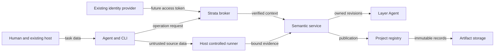

# Strata security and trust plan

Current local successor, 2026-10-04: [AGENT_ONBOARDING_PLAN.md](AGENT_ONBOARDING_PLAN.md) records subsequently implemented server-resolved fixture context, operation allowlists, optional assigned Layer/Block limits, freshness checks before cached mutation/publication, bounded local auditing and ten adapted local acceptance cases. Public fixture handles remain impersonable; hosted upstream identity, production delegation/revocation and authenticated evidence remain pending. The source-review observations below describe the earlier baseline unless marked otherwise. Use [IMPLEMENTED_CONTRACT.md](IMPLEMENTED_CONTRACT.md) for current capability claims.

Status: trust design and proposed hosted integration contract. The [implemented contract](IMPLEMENTED_CONTRACT.md) describes current fixture enforcement; hosted identity remains future work.

## Decision and scope

Keep Strata a source-control service for intent: Blocks, owned Layers, pinned Compositions, authorized Resolutions, and immutable Releases. Reuse an existing identity provider and the existing host/orchestrator. Strata must enforce its own resource and semantic permissions at the service boundary. A prompt, agent name, Git author, successful cloud login, or content hash cannot supply those permissions.

The present implementation is a **trusted, single-project, local fixture prototype**. It has semantic integrity checks and subsequently added local fixture operation/task-scope/freshness/audit guards, but no production authentication, tenant isolation, authenticated evidence or durable production delegation/revocation. Local audit records are not an independent complete security audit trail. Do not expose fixture mode to shared or public clients. The smallest later hosted milestone is one explicitly bound project with real upstream identity and the checks below; multi-tenant hosting remains deferred until separately verified.

This review covers `STRATA_MODEL.md` sections 2, 4, 6-7; `src/{cli,service,core,model,worker,local-broker,artifacts,profile,runner}.ts`; the existing test definitions and local runtime configuration; and the implemented contract, onboarding, CLI, readiness, and verification docs. It does not modify the semantic model, design an IdP, create an orchestrator, introduce cryptography, audit dependencies exhaustively, or review `site/`.

Evidence precedence: source establishes implemented checks; the model establishes proposed semantics; plans describe future work. Run [local verification](VERIFICATION.md) for current Node and Agents SDK results. Local fixture tests do not establish hosted security or independent identity.

Assumptions fixed by this bounded review: the current workstation and operator are trusted; the booking fixture contains no real customer data; future hosted callers and agent-produced content must be treated as untrusted. Internet exposure, the selected upstream IdP, data sensitivity, and operational owners must be resolved before a hosted milestone. Those choices do not block this local planning deliverable.

## System and trust boundaries

The current runtime is TypeScript/Node with Zod schemas, plus Cloudflare Agents/SQLite Durable Objects. The Node broker is an alternative development harness. Neither is an agent planning system.

The diagram is a responsibility map, not a literal RPC sequence: today the Worker routes Layer mutations through LayerAgent to ProjectAgent, which calls the shared service/core. Identity-provider integration is proposed; the existing broker uses fixture handles. Evidence currently arrives through the same operation API, not an authenticated runner channel.

| Boundary / entry point | Current channel and checks | Limit and required ownership |
| --- | --- | --- |
| Host/CLI to broker | Loopback HTTP `POST /v1/operation`; `x-strata-session` maps public fixture handles to principals. CLI rejects non-loopback URLs and redirects. Node listens on 127.0.0.1. Worker checks local-fixture configuration and URL hostname. | No secret-based identity or TLS here. The host selects trusted endpoints and supplies future credentials; the broker verifies them. A request hostname or absent Origin is not authentication. |
| HTTP to service/Agents | Closed general Agent routes, no exposed WebSocket/state-sync endpoint, Origin-bearing operation requests rejected; record schemas and semantic checks in core. `GET /health` exposes only runtime status. | Keep alternate transports closed unless they enforce the same policy. Internal RPC accepts a principal argument and relies on the Worker routing boundary; never expose that argument to clients. |
| Service to registry/store | Pinned records, immutable-value comparison and SHA-256 checks; Layer owner/head checks; complete staging before one registry publication. | Digests detect mismatches against trusted references; they do not authenticate a maliciously rewritten registry or storage administrator. Store access stays service-only. |
| Source/output files to CLI/runner | Distill enumerates and hashes source files; safePath rejects escaping paths and links. Fixed booking profile; CLI rehashes local output for validation/release. | General JSON file flags can read paths available to the process. The runner imports a local module and is not a sandbox. Host filesystem/tool restrictions remain necessary. |
| Future broker to hosting service | Remote Artifacts adapter currently fails closed. | Future storage credentials and immutable locators belong to the adapter, never the LLM. Hosting ACLs do not implement Layer ownership or semantic approval. |

Evidence anchors: `src/cli.ts:58` (`safePath`), `:80` (`runCli`), `:94` (broker call), `:135` (distill); `src/worker.ts:79` (`LayerAgent`), `:92` (fetch); `src/local-broker.ts:11` (`startLocalBroker`); `src/core.ts:71` (`Engine`); `src/runner.ts:7` (`runFixtureEvidence`); `src/artifacts.ts`.

Protect confidentiality of drafts, project intent, evidence and credentials; integrity of ownership, authority, exact revisions, approvals and publication; availability of the registry and validation flow; and attributable operational history. Relevant adversaries are a malicious project reader/author, a compromised agent or session, an untrusted imported document, and a caller attempting cross-project access. A local process with the operator's filesystem rights can also choose any known fixture session or edit the store. This is an explicit prototype trust limit, not an internet-reachable exploit claim. Host administrator, IdP, broker and storage-administrator compromise are outside the protection supplied by the current checks.

## Minimal identity and authorization contract

### Use existing standards and upstream services

1. **Human login belongs upstream.** Use the existing host/provider's OpenID Connect login. If a later CLI needs interactive authorization, reuse that provider's supported authorization-code flow with PKCE, or its device-authorization flow; do not build Strata accounts, passwords, MFA, or recovery. None is required for the local fixture. [OpenID Connect Core](https://openid.net/specs/openid-connect-core-1_0.html), [OAuth security BCP](https://www.rfc-editor.org/rfc/rfc9700.html), [device authorization](https://www.rfc-editor.org/rfc/rfc8628.html).

2. **The hosted API is a resource server.** Accept an upstream access token intended for Strata over HTTPS. Prefer the provider's supported validator; for RFC 9068 JWT access tokens validate signature, allowed algorithm, exact issuer, API audience, expiry, applicable not-before, and token type. Reject ID tokens used as API access tokens, unsigned/invalid tokens, and tokens for another resource. Trust only configured issuer/key sources; never follow token-supplied key URLs. Opaque tokens can use the provider's supported introspection instead. Choose one supported integration, not a new token format. [RFC 9068, section 4](https://www.rfc-editor.org/rfc/rfc9068.html#section-4), [JWT BCP](https://www.rfc-editor.org/rfc/rfc8725.html), [introspection](https://www.rfc-editor.org/rfc/rfc7662.html).

3. **Use stable principals.** Map the validated issuer/subject pair to an internal principal, distinguishing workload from human identities. Display names, email addresses, agent instance names and body `owner` strings are labels, not credentials. Map project membership and allowed operations from operator-controlled policy; a client-requested role or arbitrary upstream group name does not create authority. OIDC defines issuer/subject identity semantics; the application mapping is Strata policy. [OIDC claim stability](https://openid.net/specs/openid-connect-core-1_0.html#ClaimStability).

4. **Delegation narrows existing permissions.** The existing host obtains a short-lived workload identity through its provider's supported mechanism. If that provider already supports OAuth token exchange, use its delegation semantics and preserve the acting identity separately from the delegator. Otherwise use a distinct workload principal with a server-side assignment; do not impersonate the human or implement token exchange in Strata. No recursive redelegation is needed for the MVP. [OAuth token exchange](https://www.rfc-editor.org/rfc/rfc8693.html).

5. **No fixture fallback.** Hosted configuration must reject all fixture handles and fail startup/requests when its identity integration is missing. A trusted identity proxy is acceptable only with protected backend ingress and verified assertions; client-supplied identity headers alone are not acceptable. Keep bootstrap/operator privileges out of author processes and model context. No login, provider selection, credential issuance or deployment is performed by this plan.

### Division of responsibility

| Owner | Responsibility |
| --- | --- |
| Existing IdP / credential provider | Authenticate humans/workloads, protect and rotate signing keys, issue appropriately scoped/expiring credentials, provide its supported revocation/introspection mechanisms. |
| Existing orchestrator / host | Obtain identities, assign tasks, keep credentials outside prompts, enforce tool/filesystem/process/network boundaries, execute approved runners, supervise cancellation, and enforce separately authorized execution budgets. A task prompt does not enlarge permission. |
| Strata broker / shared service | Verify identity; bind tenant/project and current grants; enforce every operation's role, Layer owner, task scope and semantic authority; validate records; attribute approvals/evidence/reports; recheck publication and revocation; emit safe audit events. |
| Strata storage adapter / hosting provider | Adapter chooses authorized project namespace and immutable paths, verifies read-back, and commits publication. Provider protects repository access/transport/storage using its own identity and ACLs. |
| Operator / responsible reviewers | Establish the fixed authority manifest and assignments; review exact candidate/evidence; make authorized scope/guardian/release decisions; revoke access and review incidents. An operator credential is not a model's shared tool. |

### One service-side check path

Every public operation, including direct HTTP calls, reads, dry runs and retries, must pass the same checks before state access or mutation:

- Resolve a validated principal and a server-bound project; verify current membership, credential/grant lifetime, revocation and operation permission. A URL/config project selector is only a requested target.
- Resolve all referenced records **inside that authorized project**; apply draft visibility before returning data, lists, counts, cursors, conflicts or errors. Deny cross-project references even when their IDs or hashes are known.
- Intersect the current operation grant with the assigned Layer IDs and any explicit Block write scope. Read context can include peer Blocks without granting write scope. Bind Layer ownership at creation and preserve it across revisions.
- Apply existing strict schemas, exact-head/precondition checks, dependency/impact rules, baseline authority, evidence and approval gates. Check authority at the baseline positions; no proposal may rewrite its own authority.
- At commit, recheck current authorization/policy generation and registry version after any work outside the publication lock. Abort if revoked, expired, stale or incomplete. Do not publish partially.
- Authenticate and authorize **before returning an idempotency-cache result**, then bind the key to tenant, project, principal, operation and exact input. A retry neither restores revoked permission nor discloses an old result to another principal.

This is application authorization around the existing core, not a general policy engine. For the first hosted demo, hard-bind one configured tenant/project and reject every other target. Do not imply that adding a `tenant_id` field proves multi-tenant isolation.

### Roles, ownership and delegation

These are proposed permission groupings, not new CLI verbs or schema enums. Use explicit assignments and deny unlisted operations.

| Role | Minimum allowed actions | Boundary |
| --- | --- | --- |
| Project reader | Read authorized published records and inspect candidates. | No Layer creation, reports, evidence writes, approvals or publication. Reading all published Layers within one authorized project is intentional. |
| Layer author | Reader plus create/revise/publish assigned owned Layers, including decision-only proposals. | Cannot modify a peer's Layer, transfer ownership, grant authority, or approve a proposal by claiming a role. |
| Composition preparer | Build/persist candidates and materialize eligible pinned intent; optionally seal a fully endorsed Resolution. | Candidate construction is not authoritative selection. Exact sealed decisions still govern rejected proposals. Explicit permission is required to register derived artifacts. |
| Interaction reviewer | Inspect assigned context and submit attributed interaction reports; author a proposal only with a separate owned-Layer grant. | A report can block readiness; it is not an approval or permission to repair peers. |
| Evidence producer / behavioral reviewer | Submit results for assigned checks and exact candidate/profile/output; review only assigned review criteria. | Caller identity, executor identity and reviewer attribution must be verified. Passing evidence does not approve Release. |
| Responsible-scope selector | Endorse the exact decision or candidate/evidence within a baseline-delegated scope. | Must cover all affected baseline Blocks/consumers; cannot waive unknown evidence or grant itself a wider scope. |
| Protected-item guardian | Approve an exact amendment to its baseline-protected item. | Required in addition to scope/release approval; the `safety` facet alone grants no authority. |
| Release authority / publisher | Endorse and publish a fully validated exact candidate, or explicitly delegate final submission to a narrowly permitted publisher. | Publishing requires both caller permission and all bound endorsements. Release grants no deployment or spending permission. |
| Project administrator / bootstrap operator | Establish initial membership/assignments and fixed authority; suspend access. | Does not bypass semantic gates or edit immutable records. Ordinary Layer operations cannot change the authority manifest. |

Current `authorities.scopes[].selectors`, `authorities.guardians`, and `authorities.release` remain the semantic authority source. Current `compose` and `release` service calls do not check these proposed caller roles: describe the existing endorsement gate accurately until implementation changes.

Keep author, evidence and privileged operator roles separate for the demo. Any deliberate combination of human roles must be an explicit project policy, not an automatic union inherited by child agents. The host can request assignments only within its permitted delegation scope. An assignment should bind the grantee, project, permitted operations, Layer IDs, optional Block write scope, delegator and expiry in server-controlled policy. Ownership persists as provenance after the assignment expires; a new task cannot take over an existing Layer merely by reusing its name. Ownership transfer and general authority-governance changes remain deferred.

### Normalized context for core and onboarding

Proposed internal `SecurityContext` and future `status.data.security_context` use the following names. They are a handoff contract, **not implemented fields, signed tokens, semantic-record extensions, or editable task-manifest settings**. A client must not manufacture them. Use existing provider tokens and server policy to populate the context.

| Field | Meaning |
| --- | --- |
| `trust_mode` | `local_fixture` or `upstream_authenticated`; local mode must never be relabeled as authenticated hosting. |
| `principal_id`, `principal_kind` | Stable server-mapped principal and human/workload classification. |
| `tenant_id`, `project_id` | Authorized server namespace, even when fixed to one project. |
| `allowed_operations` | Effective allowlist for this caller, not the CLI's list of supported commands. |
| `layer_ids`, `write_block_ids` | Enforced task restrictions where supplied; explicit policy distinguishes unrestricted authorized scope from an empty denied set. |
| `grant_id`, `delegator_id`, `expires_at` | Nonsecret assignment reference, delegator if applicable, and validity boundary. |
| `policy_version`, `authority_ref` | Current access-policy generation and pinned baseline authority reference; both are needed. |

Expose only safe metadata needed by that caller. Current `status` has `identity_policy` and owned heads, not this manifest. Onboarding must label scope unavailable until the broker implements introspection; it must not infer it from its advisory packet. Preserve existing semantic `owner`, approval payloads, exact references, JSON envelope and exit-code behavior. Missing/invalid authentication or denied permission remains exit 4; stale semantic inputs use 5, missing evidence/endorsement 6, and remote/cost denial 7.

## Git protocol is not hosting identity

Git defines objects, references and transfer protocols; access control comes from the chosen transport/server and hosting service. A commit's author/committer fields are configurable metadata. Neither a name/email nor a content OID proves the authenticated caller or grants a Strata role. A verified signature, if later adopted through existing tooling, still needs an authorized signer/context policy; do not add custom signing. [Git transports](https://git-scm.com/book/en/v2/Git-on-the-Server-The-Protocols), [Git commit identity options](https://git-scm.com/docs/git-commit).

Cloudflare's documented Artifacts interfaces distinguish runtime bindings, control-plane API tokens, and repo-scoped Git tokens. A Git write token gives repository writes, not per-Layer or per-Block permissions. Existing Wrangler or GitHub login is not a Strata principal. [Artifacts authentication](https://developers.cloudflare.com/artifacts/guides/authentication/), [Git protocol authentication](https://developers.cloudflare.com/artifacts/api/git-protocol/).

Therefore the future adapter is the only holder of a storage write credential. Strata authorizes the semantic operation first, chooses the namespace/path, stages immutable records, verifies exact commit-qualified read-back and semantic SHA-256, then publishes the registry locator. Never accept an arbitrary client-supplied remote or trust a mutable branch name as publication evidence. Keep Git OIDs distinct from semantic digests; reject conflicting writes/force replacement at immutable addresses. Repository deletion/admin permissions stay with the authorized operator path. Reuse the [adapter contract](ARTIFACTS_REGISTRY_INTEGRATION.md); this review executes no Git or hosting operation.

## Actual prototype gaps and abuse paths

These are static source findings, not newly executed exploit tests. Priority is a **gate for shared/hosted use**. In the trusted local fixture, the same conditions are disclosed limitations. No critical internet vulnerability is asserted for a loopback-only deployment.

| ID / priority | Concrete abuse path and evidence | Existing protection and gap | Minimum response |
| --- | --- | --- | --- |
| ST-01 / high | A reachable local caller chooses `fixture-release` or another known `x-strata-session` value and acts as that principal. `SESSIONS` in `src/local-broker.ts:9` and `src/worker.ts:12`. | Body-owner mismatch and `--actor` spoofing are refused, but handles are public selectors, without expiry or proof of possession. High likelihood for a hostile local process; high approval/ownership impact. | Keep fixture mode local/trusted; upstream authentication and explicit hosted fixture rejection. Tests must distinguish body spoofing from session impersonation. |
| ST-02 / high | A fixture reader supplies `owner: reader` to create a Layer, persists a Composition/report or submits evidence; any authenticated caller can invoke Release with valid stored endorsements. `src/service.ts:5`, `Engine.layer/compose/validate/release`. | Owner and endorsement checks work; there is no complete operation-role gate or enforced assigned Layer/Block scope. High likelihood once a reader is admitted; high integrity/availability impact. | Shared operation allowlist, task-scope checks and explicit publisher permission. Do not claim that valid endorsements alone authenticate the submitting caller. |
| ST-03 / high | Multiple configured clients pointed at one broker share records; a guessed ref can cross their assumed project boundary. Worker uses fixed `strata-project` / `local-artifacts` and bare Layer IDs; CLI `project_id` is not sent as an authorized server namespace. | Draft owner filtering exists, but no tenant membership or namespaced lookup. High likelihood/high impact **if reused for multiple projects**; not a proven cross-tenant exploit in today's single-project setup. | Hard-bind one project now; namespace and authorize every Agent, registry, cache, cursor and artifact lookup before multi-tenant claims. |
| ST-04 / high | A caller constructs passing evidence using the accepted executor string and `fixture-reviewer`; exact candidate/profile/output digests are discoverable. `model.ts:evidenceSchema`, `core.ts:validate`, `runner.ts:runFixtureEvidence`. | Exact binding, check completeness and approval gates exist. Literal executor/reviewer labels do not establish execution or reviewer identity. High likelihood for a malicious admitted writer; high evidence-integrity impact, with endorsements still required. | Authenticate the assigned producer/reviewer; collect results through the host-owned run boundary. Keep `local-fixture-import` explicit; no independent-attestation claim. |
| ST-05 / high | A malicious source/peer message asks an agent to read a credential or switch role; a changed output module is imported by the trusted runner. `cli.ts:jsonFile/safePath/distill`, `runner.ts:8`. | Distill performs no inference or embedded command execution; fixed profile and path checks reduce exposure. The host/runner has process privileges; content is not a security boundary. Medium likelihood conditional on agent/tool or file access; high execution/data impact. | Treat content as data; host tool/filesystem/egress restrictions; verify exact output immediately before execution in an isolated unprivileged host runner. Do not claim prompt-injection immunity. |
| ST-06 / high | A secret included in intent/source-derived prose, diagnostics, evidence or a future storage URL persists in immutable artifacts and traces. CLI emits error details; brokers pass error messages; there is no general secret-screening/redaction boundary. | `config show` redacts the session indicator and no provider token is currently required. No observed secret leak is asserted. Medium likelihood with real data/credentials; high disclosure impact. | Keep credentials out of all semantic content, validate allowed metadata, redact at output/log boundaries, and review exports. Secret scanning is supplementary, not a guarantee. |
| ST-07 / high | A revoked grant or compromised approver's old endorsement continues to authorize a pending release; a cached mutation result returns without a current policy check. Broker request memo paths and fixed baseline manifests contain no revocation state. | Exact digest binding prevents stale-content substitution, not revoked authority. High likelihood after a revocation event; high release-integrity impact. | Live access deny overlay, short credential lifetime, fresh authorization before cache/commit, and revocation-aware pending approval/Resolution checks. Preserve historical records. |
| ST-08 / medium | A reader floods persistent reports/candidates and blocks readiness; operations reload/restage the whole registry. Worker parses request JSON without an application size cap; Node caps accumulated text at roughly 1 MiB. | Closed routes, bounded inspect pages, serialized publication and idempotency help, but no per-principal quotas, queue bounds, consistent depth/size limits or complete audit ledger. High likelihood for admitted misuse; medium demo availability/accountability impact. | Operation grants plus byte/depth/count/time/queue limits; incremental staging under the existing core task; attribute denied and committed attempts in a bounded audit sink. |

Cross-Layer overwrite protection is real **when the broker principal is trusted**: `Engine.layer` checks owner/head, `publish` checks the owner, and `inspect` filters private drafts. LayerAgent also pins its instance owner. ST-01 compromises that precondition; ST-02 concerns broader operation/task permissions. Neither should be misreported as absence of all ownership checks.

CLI `validate`/`release` rehash local output, but direct broker calls validate the stored realization and supplied evidence, not the caller's disk. That is a distinct boundary, not equivalent protection. For hosted use, the authoritative evidence must identify bytes measured by the trusted execution boundary; making a client promise it rehashed files is insufficient.

Impact routing covers declared baseline relationships/criterion subjects. It cannot discover undeclared consumers or arbitrary prose contradictions. Review must widen uncertain impact and preserve the bounded-profile limitation; neither authentication nor the `safety` facet proves semantic completeness.

## Revocation, audit and content handling

**Revocation:** use provider-supported credential revocation/introspection where available, plus a current Strata assignment/membership deny state. Revoking a token at an authorization server does not make every already-issued self-contained token instantly invalid at a resource server; document token/cache lifetime and fail closed when required freshness cannot be established. [Token revocation](https://www.rfc-editor.org/rfc/rfc7009.html), [introspection and caching](https://www.rfc-editor.org/rfc/rfc7662.html).

Pinned authority and live denial are conjunctive: the historical manifest can authorize a scope, but current suspension can veto its use; current membership cannot invent a missing baseline authority. Conservatively invalidate suspended principals' endorsements for **unpublished** Releases, including endorsements behind sealed Resolutions, until a currently authorized reviewer re-endorses exact content. Check this again at commit, including after staging. Preserve existing Release bytes and audit the incident; any trust warning or remediation is a separate record/action. Revoke run storage credentials through the hosting provider when that approved run ends; expiry/revocation does not remove copied data or stored repositories.

**Audit:** record a unique server event ID, server timestamp, request/operation correlation, tenant/project, validated acting principal and delegator where applicable, nonsecret grant/policy references, action, target refs/digests, allow/deny outcome and safe reason, publication outcome and returned Release. Record failed auth/authorization and policy changes as well as successful writes. Use a bounded durable append-only application sink with a publication-transaction event/outbox for committed writes; restrict log reads and writes. Do not create a cryptographic ledger. Current deterministic `operation_id`, idempotency cache, artifact provenance and `wrangler.jsonc` with observability disabled are not this audit trail. An application append-only rule does not protect against a storage administrator.

**Untrusted content and secrets:** Layer prose, distillation sources, tool results and generated files cannot change tool permissions, identity, destinations, budgets or authority. Invoke allowlisted tools with argument arrays; never interpolate that text into shell code. Do not execute repository hooks, arbitrary profiles, evidence commands or package installs as a consequence of importing records. Rehash and bind the runner input; use the existing host's sandbox/isolation rather than adding a Strata executor platform. Do not claim that safePath removes filesystem races against a hostile same-user process.

Keep tokens in the existing credential store/host transport or adapter memory; do not place them in CLI arguments, remote URLs, prompts, tracked configuration, errors, semantic records or test fixtures. Environment injection is a transport convenience, not protection from a process with the same OS access. Redact before logging/export and restrict raw source/evidence retention. After a discovered leak, stop propagation, revoke/rotate through the authorized provider workflow, identify affected copies and retained artifacts, and document remaining exposure; immutability and local deletion do not guarantee erasure.

## Minimal MVP security acceptance

Extend the existing core/CLI test harness in its owning task; do not create testing agents or a new test framework. The following cases are **recommended, not run by this review**. Use deterministic fixtures/fake provider responses and isolated local stores. Exercise direct broker calls as well as CLI behavior so a CLI-only check cannot satisfy a server requirement. Remote/model execution requires an explicit current host grant and cost boundary.

| ID | Smallest meaningful acceptance | Current evidence / gap |
| --- | --- | --- |
| SEC-01 Identity | Missing session, body `owner`/`--actor` spoofing fail; hosted mode rejects every fixture handle, wrong issuer/audience/type/signature, expired/not-yet-valid access and untrusted key URL. | Body/flag/missing-session cases exist in `tests/cli.test.ts`; hosted verifier cases pending. Record the known fixture-session impersonation limitation explicitly. |
| SEC-02 Roles and ownership | Reader cannot mutate; author cannot revise/publish peer Layers, use an unassigned Layer/Block or approve/release; owner/head/peer bytes stay unchanged on refusal. Test the same denial via HTTP and dry run. | Existing ownership/head tests cover a subset. Per-operation roles and task assignment pending. |
| SEC-03 Project boundary | Two isolated project fixtures deliberately reuse IDs, hashes and idempotency keys; cross-project read/write/list/cursor/artifact/Agent access fails without existence leakage. Single-project mode rejects a second target. | Pending. Do not label current single-project tests tenant-isolation tests. |
| SEC-04 Authority and review | Only baseline-authorized scope/guardian/release identities endorse; changed candidate/evidence/considered set invalidates old records; author labels/facets cannot widen authority. | Existing core tests cover baseline scope, guardian and stale-context cases. Add caller-role checks; retain exact-content behavior. |
| SEC-05 Evidence trust | Tampered/missing/extra output, stale/failed/incomplete results block; an author cannot attest as the runner/reviewer merely by copying accepted labels. Direct HTTP must not bypass producer identity. | Existing tests cover byte/context/check validation. Producer/reviewer authentication pending; local fixture attestation remains labeled. |
| SEC-06 Revocation race | Suspend author/publisher/approver before request and between stage/commit; deny new writes, cached-result disclosure and pending Release. Old Release bytes remain unchanged. | Pending. Include sealed-Resolution endorsements and queued work, not just token expiry. |
| SEC-07 Untrusted inputs | Traversal/link escapes and arbitrary profile/evidence commands fail; hostile prose cannot change the tool allowlist/session or trigger egress. Replaced runner module fails measurement before import. | CLI path/profile/source cases exist. Host isolation and pre-execution measurement need explicit coverage. No live LLM is required for policy enforcement tests. |
| SEC-08 Publication and retries | Stage failure publishes nothing; lost response/duplicate requests return one Release; cross-principal/project key reuse cannot reuse a result; stale policy/index version fails commit. | Recovery/duplicate tests exist locally. Namespace/policy-race checks pending, especially when shortening the ProjectAgent critical section. |
| SEC-09 Secrets and audit | Synthetic token canaries never enter stdout/errors/logs/artifacts; allowed and denied attempts have attributable safe events; committed Release has a durable correlated event; log failure follows a defined fail-closed privileged-write policy. | Session indicator redaction exists; generalized output filtering and audit coverage pending. Use fake canaries, never real credentials. |
| SEC-10 Bounds and remote denial | Oversized/deep/too-many-item requests fail before expensive work; bounded report/mutation queues; fixture mode never contacts provider/storage/telemetry endpoints or enables remote fallback. | Loopback/remote-adapter refusal exists; server quotas and consistent resource limits pending. Offline fake tests do not prove cloud billing limits. |

Save only sanitized request/result metadata, refusal codes, unchanged-record digests and publication/audit correlations. Existing tests and reported passes can be reused; run additional checks only for implemented gaps or changed behavior. A future real-runtime matrix must distinguish Node harness results from actual local Cloudflare coverage. No remote operation is a prerequisite for writing or reviewing these cases.

## Dependencies and honest production limits

Reuse current pinned Zod schemas, Agents facilities, Node SHA-256 and provider-supported identity libraries. Installed `agents@0.26.0` and `zod@4.6.5` declare MIT in their package metadata; that observation is not a transitive license/security audit. If the hosted adapter needs JWT/JWKS validation beyond a supported provider SDK, [panva/jose](https://github.com/panva/jose) is an established MIT-licensed option documenting Node and Cloudflare Workers support. It is a candidate, not an installed or approved dependency in this pass. Do not hand-roll JWT verification, key exchange, passwords, token issuance or signatures.

At the implementation boundary, verify exact selected versions, runtime support, provenance, licenses/notices and relevant advisories; pin the reviewed version and preserve required notices. Use documented interfaces and code with permission; do not copy proprietary implementations. The project license remains an owner decision. Reputable dependencies and standards reduce reinvention; they provide no guarantee of non-infringement, vulnerability absence, or product originality.

Production limitations to state in demos/docs:

- Fixture sessions and imported review/evidence are simulations, without authenticated human consent or independent execution attestation.
- No verified multi-tenant boundary, production token lifecycle, complete role/delegation policy, tamper-resistant audit operations, or hostile-local-process isolation exists.
- The fixed booking profile and declared checks do not prove arbitrary intent, complete impact, or generated-code safety. Release is semantic publication, not deployment.
- Local hashes and atomic publication preserve bounded consistency; they are not signatures, a distributed transaction, a disaster-recovery guarantee, or protection against an administrator rewriting the trust root.
- Actual remote Artifacts integration and hosted authentication remain readiness gates. Existing login, fixture approval, or an empty usage array provides no cost authorization. Keep remote calls disabled until the already established concrete run-approval process is satisfied.

## Integration requirements

Hosted writers need upstream identity verification, project/role membership, revocation, policy-version rechecks and safe audit before exposure. Keep semantic authority separate from account access. Agent instructions must distinguish read context from write permission and must not solve a refusal by switching identity. Align with the [onboarding contract](AGENT_ONBOARDING_PLAN.md).
