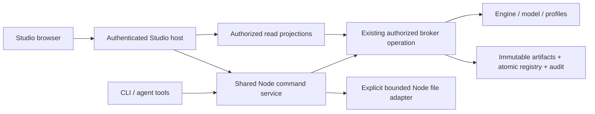

# Strata Studio: creation, change, and review

The architecture phase is complete. See [implemented scope and integration status](STATUS.md) for the subsequent authorized coding milestone; this document preserves the original design and acceptance targets.

Status: architecture decision for implementation, 2026-10-09. No application behavior is implemented by this document. Inspected base: `a54550efcb5b85e266d6f7d218a2ef423c5e2c0e`. Implement after the parent switches to Sol 6.1 XHigh; return to Astra High for substantial engine or visual decisions. See [UI plan](UI_PLAN.md), [hosted authoring contract](HOSTED_WRITES.md), and [delivery and acceptance](IMPLEMENTATION.md).

Studio becomes the single web surface for authoring, reading, and reviewing Strata intent. CLI and agents operate on the same immutable records through the same authority and execution contracts. Retain the existing Explorer design. A published Layer is a proposal; a selected Composition is a candidate; passing evidence, scope approval, and Release approval are separate facts.

## 1. Current capability inventory

The implementation, rather than the website demonstration, is the source of truth.

| Capability | Actual implementation today | Studio decision |
| --- | --- | --- |
| Browse intent and history | `src/explorer/{read,validate,source}.ts`; `explorer/{application-map,blocks,records,compare,readable}.js` | Keep map, cards, relationships, exact-ref navigation and evidence disclosures. |
| Prepare changes | `explorer/draft-model.js` exports temporary `set_item` Layers; no repository save | Add durable Save draft through existing Layer operations; export remains available. |
| Initialize intent | `Engine.init` stores one complete normalized snapshot as a bootstrap Release; refuses replacement | Create intent in an already configured empty project. No provisioning or silent scaffold baseline. |
| Create Blocks after bootstrap | Not supported: `normalizeLayer` admits only `set_item` | Add the explicit versioned extension in section 6; never invent UI-only Blocks. |
| Revise, publish, restore | `Engine.layer/publish`, `recovery.ts`, CLI `layer create/revise/publish/restore` | Owned drafts, exact heads, immutable revisions; publication does not select. |
| Prepared source proposals | CLI `distill`, `derived_from`, exact source/draft review | Show traceability and unresolved questions; no automatic inference. |
| Selection and conflict review | `compose`, `conflicts`, `resolve`, decision-only Layers; v0.2 `mediation.prepare/respond`, `reports.dispose` | Reuse domain records and version-specific decision contracts, not demo response endpoints. |
| Evidence and Release | `materialize`, `realization.register`, `validate`, `approve`, `release`; finite compiled profiles | Expose supported operations and exact missing gates. No generic arbitrary-application checker. |
| Local output verification | CLI `safePath/verifyOutput`, materialization export and Release preflight | Extract into a shared Node command service before exposing those actions in Studio. |
| Native Git/source drift | `source.*`, `git.*`, `drift.*`, bounded explicit Node backend | Preserve and surface existing records/capabilities; no default Git apply or filesystem capability. |
| Navigation baseline | `context.show/use` with expected generation | Explicit personal context only. No mutable project-wide accepted head is needed. |
| Browser writes / chat | Connection catalog hardcodes both unavailable | New explicit local write adapter; chat remains handoff until a real bridge exists. |
| Remote reads | Server-side Artifacts config, source grant, repository pin, immutable generation | Preserve read-only access and budgets. Reads confer no writes. |
| Persistent hosting | Existing host is loopback preview with an expiring in-memory bearer session | Separate authenticated hosted-read-only mode; section 8. |

Evidence: [implemented contract](../IMPLEMENTED_CONTRACT.md), [model schemas](../../src/model.ts), [engine](../../src/core.ts), [service dispatch](../../src/service.ts), [CLI](../../src/cli.ts), [security](../../src/security.ts), [Node broker](../../src/local-broker.ts), [reader](../../src/explorer/read.ts), [connections](../../src/explorer/connections.ts). No root/ancestor `AGENTS.md` or `.agents/skills` was present in this checkout; [the repository agent contract](../../agent/strata/SKILL.md) was inspected as an integration reference.

The inspected marketing checkout demo (`site/public/assets/checkout-demo.js` at the base commit) explicitly simulates checks. Adopt its readable proposal/selection/invalidation interaction, never its `validated` boolean as evidence. The real demo operator/review modules illustrate exact packets and separate endorsement stages, but their scenario orchestration, self-declared operator identity, provisioning, model invocations and cleanup do not become Studio services. The marketing site is moving to a separate repository; Studio has no build/runtime dependency on it.

## 2. Shared execution boundary

Create `src/commands/` for typed command inputs/results, broker transport, and Node orchestration. `src/cli.ts` remains argument/stdin parsing and JSON/human formatting. Studio calls TypeScript functions, never constructs shell commands or calls `runCli` with fake environment variables. Extract existing behavior first, including output-byte checks and error/exit semantics; do not duplicate it in the browser.

`executeAuthorized` and the broker remain authoritative. Mutation receipts, idempotency cache, commit audit and registry index stay there. Studio stores no second semantic database. Node file operations remain separate from pure engine operations, with explicit host-assigned project paths/output slots. SDK callers retain backend limitations, including unsupported checker-bound/binary execution.

Add broker-backed read projections for a connected local project. They must use principal-filtered records and current policy, not give the browser a raw registry containing other owners' private drafts. Keep the existing historical remote reader and fixed-snapshot labels. Never merge a local write source with a remote registry just because their display names or project IDs match: require an exact host-verified storage/project/model binding. A binding mismatch disables writes.

## 3. Proposed public contracts and operation mapping

Existing broker endpoint: `POST /v1/operation`, headers `x-strata-session`, `x-strata-project`, `x-strata-artifact-adapter`; body `{command,input,options:{dry_run,idempotency_key}}`. Broker rejects browser Origin headers. Preserve that boundary. The host uses an already assigned server-side identity, never an actor supplied by the browser. The local fixture identity remains explicitly local trust, not production authentication.

New Studio API: `studio/1`, under `/studio/v1/`. Existing `/explorer/v1/` remains a read-compatible alias. No mutation routes are added to the old read API.

| Proposed API / shared operation | CLI surface | Purpose / binding |
| --- | --- | --- |
| `GET capabilities` / `capabilities` | `capabilities [--target REF]` | Supported, configured, authorized and currently ready are separate fields for each operation. Include backend/model/profile limits, principal, policy generation, source binding and expiry; redact secrets. |
| `GET review/inbox` / `review.inbox` | `review inbox [--baseline REF] [--limit N] [--cursor C]` | Bounded derived queue from visible records, not mutable workflow statuses. Cursor binds filters, principal and generation. |
| `GET review/state?ref=REF` / `review.state` | `review state REF` | Shared gate report, authoritative current-policy or explicitly historical/unavailable. |
| `POST preview` / `layer.preview` | `layer preview --file F` | Pure normalization/projection, including owned exact draft inputs; no records, head allocation, evidence or approvals. |
| `POST operation` | Existing commands below | Positive per-command allowlist, typed inputs, idempotency and expected-view envelope. |
| `GET operation?key=K` / `operation.inspect` | `operation inspect KEY` | Principal-scoped committed outcome reconciliation; not-found does not prove an in-flight write was canceled. |

New projection/receipt operations need explicit authorization policy entries, bounded schemas, auditing where applicable, and equivalent Node/SDK dispatch. Read projections may use existing inspect permissions without adding visibility. `review TYPE REF` continues unchanged; extend its parser with explicit `inbox/state`, not ambiguous record-type aliases.

`POST operation` accepts `{command,input,idempotency_key,expected:{connection_generation,policy_generation,subject_ref,subject_digest}}`; omit subject only for initial creation. Host validates generation before dispatch; the broker rechecks current authority and semantic preconditions at commit. A stale read generation is a UX guard, never a replacement for `previous`, exact baseline, candidate/evidence fingerprints or policy checks. Existing revision/publish payloads stay canonical; route `subject_ref` must match the command input.

| Studio action | Existing command / broker input |
| --- | --- |
| Create initial intent | `init --file F` → `init {record}` in an empty configured project only |
| Save draft / save revision | `layer create --file F` → `layer.create {record}`; `layer revise REF --file F` → `layer.revise {previous,record}` |
| Publish this revision | `layer publish REF [--review F] [--authoring-review REF]` → `{ref,review?,authoring_review?}` |
| Record content review | `content review --file F` → `content.review {record}` with full normalized draft, expected digest, accepted and rationale |
| Compose considered Layers | `compose --file F` → `compose {record}`; retain the persisted ref even when blocked / CLI exit 5 |
| Inspect/report conflicts | `conflicts REF [--report F]` → `conflicts` or `conflicts.report {target,report?}` |
| Resolve a selection | Owned decision Layer, explicit approval, `resolve --file F [--approval A]` → `resolve {record}`; use v0.2 mediation operations where active |
| Materialize | `materialize REF --profile ID --out DIR` → shared orchestration of `materialize {target,profile}`, `realization.register {record}`, bounded export |
| Import validation | `validate REF --realization MANIFEST --evidence F` → verify local outputs, then `validate {target,realization,evidence}` |
| Approve scope / guardian / Release | `approve --file F` → `approve {record}`; exact versioned payload and authorized kind |
| Publish Release | `release REF --validation V --approval A` → same local-byte preflight, then `release {target,validation,approvals}` |
| Continue from Release | `context use REF --expect-generation N`; new Layers name that baseline explicitly |
| Restore draft content | `layer restore CURRENT --from PRIOR`; new private revision, no inherited reviews |

No `run checks` action exists unless a separately supported finite runner adapter is configured. Initially, use a readable runner handoff and import its actual output. UI-supplied paths never choose arbitrary server files: materialization uses configured output roots/slots, source reads use exact approved manifests, and evidence can be submitted as bounded JSON. CLI file loading and Studio upload/slot resolution converge on identical typed command inputs. Unknown profiles return unsupported, not a checkbox to waive coverage.

## 4. Gate report and review visibility

`review.state` returns exact subject ref/digest, baseline/model, view generation, candidate fingerprint if defined, trust mode, and gate rows `{id,state,code,subject_refs,required_role,operation,reason}`. States are `satisfied`, `missing`, `blocked`, `stale`, `unsupported`, `not_applicable`, `unavailable`. Never use a percentage as approval readiness.

Extract gate predicates used by mutation checks so review diagnostics and commit decisions cannot drift. Compute independently evaluable gates even when an earlier one fails; mark dependent checks unavailable rather than fabricate a result. Preserve existing first-error mutation exits for compatibility. A read-only gate report does not call `approve`/`validate` or mutate a cloned engine as a substitute for a proper projection. Final operations always recompute their gates.

Required rows: ownership/head; source review and unresolved questions; v0.2 authoring review; publication of exact inputs; complete considered set and dependency/cardinality constraints; atomic collisions; sealed selection and current mediation/report state; baseline authority; supported realization/profile/obligation coverage; actual retained output bytes where configured; candidate/profile/output/checker/fixture/oracle evidence binding; required criterion results and review attestations; scope approval; affected guardians; Release approval; current operation permission and persistence availability. Source/Git application approval remains its own gate if that backend is explicitly used.

Inbox entries show what this principal can see and do. Owners see their drafts; published proposals are visible through existing read permissions. The existing one-draft remote review grant is not a project-wide private inbox. For content review, retain the existing exact draft handoff contract (full draft plus digest); another reviewer cannot browse private records merely because they can attest. An exact host-configured draft-read grant must be checked by both CLI and Studio if that capability is later added. This implementation must not grant it automatically.

Questions are not a separate approval system. Resolving supplied-proposal questions requires a new owned revision with corrected content/rationale/traceability; previous draft and questions remain inspectable. Show the difference and obtain fresh exact review. No button merely sets `questions=[]` to unblock publication.

## 5. Candidate, baseline and lifecycle

Use three explicit modes: **Baseline**, **Proposal preview**, **Candidate**. A preview foregrounds proposed readable content and links the prior values; it has no validation state. An evaluated candidate exists only for exact published inputs. A blocked Composition shows competing values, never an arbitrary effective winner. The remote v0.2 reader currently cannot evaluate current policy; preserve `effective_available:false` there rather than implying the writer's authority is available remotely.

Bootstrap is already a supported lifecycle operation: `init` consumes a complete Block tree plus explicit scope/Release/guardian authority in an empty project. The create flow asks for real initial purpose and Blocks, obligations and host-approved authority configuration, then previews the normalized snapshot. Initial editor content is transient until this existing atomic operation succeeds. Never persist empty placeholder intent as an accepted Release to make the wizard work. Empty/missing authority is reported as a blocker, not repaired by choosing the current user.

Retain the reader's existing **Bootstrap baseline — no publication evidence recorded** label. `Engine.target(release)` returning `state:validated` alone does not establish receipts; use retained publication/evidence fields and shared gate projection. `init` is initialization authority, not evidence-backed Release approval.

After a real Release, offer explicit personal context change. Old Layers never rebase automatically. New work uses a new Layer with that exact Release; history, obligations and lineage come from the Release snapshot. No new global current-baseline pointer or promote operation is necessary. Replacing existing initialization/repairing immutable baseline authority is outside this slice: expose the blocker and supported host/migration handoff, never re-run init over live records.

## 6. Smallest post-bootstrap Block extension (later phase)

Choose an opt-in new model `strata/0.3-block-lifecycle-experimental` with capability `block-create/1`, based on the v0.2 content/mediation rules. Do not widen the old strict schemas or silently reinterpret old hashes. Activate only in fresh explicitly configured synthetic projects initially; existing projects remain v0.1/v0.2. No automatic migration or cross-version composition. This decision avoids treating a new structural operation as an old client's understood `set_item`.

Extend the versioned Layer with `created_blocks: Block[]` (sorted by ID; old models reject it). Existing `changes` still edits baseline items. Creation requires a full normalized v0.2-shaped Block, a parent that exists in the pinned baseline, and absence from baseline Blocks/deleted IDs. The first extension adds children of existing Blocks only; no root replacement, multi-level new subtree, delete, reparent, authority change or collection removal. Edit a newly proposed Block by revising its owning Layer's complete creation record; `set_item` against a not-yet-baseline Block remains unsupported.

Ownership is the authenticated Layer owner, not a new Block owner field. Add an explicit host-side `create_under_block_ids` assignment and capability; existing write permissions do not imply creation. The parent must be permitted. Scope/impact is calculated against baseline authority using each new Block's baseline parent anchor plus affected existing relationship consumers and criterion subjects. The proposal cannot grant selectors, guardians or release rights. Initially prohibit new `invariant` requirements in created Blocks until fixed guardian assignment has a separate reviewed contract; existing invariants/guardians are unchanged.

Normalize creations before validating the complete prospective tree and its acceptance references. Criteria and relationships must point to real baseline or same-Layer created items; no dangling references or invented interfaces. Distinct selected Layers claiming the same new Block ID conflict even if bytes are equal: creation identity must not silently acquire two owners. Unselected alternatives are retained. Selection is whole-Layer and conflicts use the existing sealed Resolution process. Cross-Layer edits to another Layer's new Block wait until a Release makes it baseline; no application-order semantics.

Creation provenance records the owning exact Layer for the Block creation and every authored atomic item. Compose/Release conserve all new obligations, lineage and deleted-ID rules; restored revisions preserve history and require fresh review. Distill trace coverage must include created purpose, requirements, acceptance, relationships and contracts. No prepared source proposal may use creation to avoid unresolved questions.

Model/parser dispatch, Engine normalization/evaluation/snapshot flattening, scope computation, security, mediation, schemas, storage readers, backup closure, review, CLI and UI must recognize the version together. Finite profiles must opt in explicitly and reject unsupported created content. A new model alone does not supply a realization/checker. The first full extension test may use one bounded synthetic profile; arbitrary prose remains editable/reviewable but not automatically realizable or releasable.

## 7. Safe local write mode and persistence

Default remains read-only. New local write mode requires trusted startup configuration for one existing loopback broker, exact project/model/storage, assigned server principal, allowed operation subset and optional bounded filesystem adapter. Proposed launch: `strata studio --project PATH --write-config ABSOLUTE_PATH`; no auth/role chooser or API key textbox. The config describes existing assignments; it creates no credentials or grants. Current remote/sample adapters cannot enable writes by toggling a browser flag.

Keep the loopback host's positive Host/Origin/fetch-site rules, memory-only launch capability, CSP, no CORS, redirect refusal, input/node/depth bounds, deadlines and queue bounds. Limit operation JSON to the broker's 1 MiB/32 levels/20,000 nodes; retain stricter settings/refresh limits. Disallow browser fault-injection and raw arbitrary commands. Advertised actions are the intersection of adapter support, configuration, current role, target scope and readiness.

Persist Save draft through `layer.create/revise` only. Unsaved text stays in browser memory, with dirty-navigation protection and an explicit export option. Published and prior revisions remain immutable. Commit the exact idempotency receipt with the existing registry/audit transaction. Add `operation.inspect` over principal-scoped receipt metadata, with no raw input/secret audit content. Recheck permission on cached responses; avoid process-local success flags as the durable truth.

The browser retains its idempotency key and exact request while awaiting/retrying; no new key on repeated clicks. A payload edit gets a new key. A timeout after dispatch is **Outcome unknown — check saved result**. Cancel aborts a read or an unsent edit; it does not undo a committed write. On reload/restart reconstruct saved state from owned heads, immutable records and durable receipts. Browser storage need not retain drafts or capabilities. After an ambiguous reload, inspect the exact proposed revision before authoring a new one.

Disk failure after realization registration may leave an immutable record without complete local files. Show that partial result and require a fresh empty output slot/verification before proceeding. Do not silently overwrite outputs or claim export is fully idempotent. Failed staging leaves no published Release; orphan stages are not inbox records. Audit failure closes mutation. Release commit and lost-response retry retain existing atomic index semantics.

## 8. Persistent customer-hosted mode

The requested private deployment uses the same existing container as the marketing website, with a separate Studio hostname and owner-managed reverse proxy entry. Keep actual container addresses, paths, credentials and receipts outside this repository. Studio must remain independently deployable; marketing assets/services are not runtime dependencies.

Add explicit `hosted-read-only` mode beside `local-preview`, never infer it from bind address. Host-specific modules/configuration belong under `src/explorer/` and generic `docs/studio/self-hosting` / `deploy/studio` in the hosting task. An unconfigured installation serves only a static setup/login shell; project APIs fail closed. Persistent process uptime must not make access sessions or source grants permanent.

The supported initial hosted contract is:

- A loopback application service behind the configured reverse proxy; exact public HTTPS origin and Host allowlists. Accept forwarded host/proto only from explicit trusted proxy peers. Reject wildcard hosts, multiple/conflicting forwarded values, unexpected schemes and direct untrusted proxy headers. TLS termination/routing alone is not authentication.
- An owner-provisioned high-entropy access key or separately implemented trusted auth adapter. Initial key setup is a protected server-side file/hash; login accepts it only via bounded HTTPS POST. Never place keys in URLs, logs, command arguments, analytics or repository config. No default key. No anonymous data route when key setup is missing. The setup shell cannot configure secrets remotely.
- Opaque server-side sessions via `__Host-strata_studio`, `HttpOnly`, `Secure`, `SameSite=Strict`, `Path=/`, no Domain. Absolute expiry at most eight hours and idle expiry at most thirty minutes; rotate at login and on a bounded interval (target fifteen minutes) without extending absolute expiry. Restart may invalidate sessions. Logout/key rotation revokes access; bounded login attempts and session counts. Cookie authentication is not a Strata approval identity.
- Exact Origin validation plus session-bound CSRF tokens for state-changing requests, including session connection actions; login has its own anti-CSRF/origin checks. CSRF rotation follows session rotation. No capability-bearing URL fragments in hosted mode. Auth failures clear private client data; public semantic deep links contain no secrets and require login.
- Existing Artifacts settings stay server-side: immutable repository/project/model pins, source authorization expiry, allowed read operations and request/byte budgets. Hosted session expiry cannot exceed the applicable source authorization for data access. Browser sees redacted connection/capability status only; no provider tokens or environment references. Disconnected/read-grant-expired means unavailable, not a cached bypass or automatic renewal.
- In the first hosting slice, hosted writes and agent calls remain disabled. `FixtureIssuer` explicitly cannot establish hosted identity; do not expose public fixture handles as login, reuse the read key as a publisher, or proxy a more privileged fixture for all web users. Full persistent creation/change/review is the destination, implemented through the [named actor, issuer, grant and evidence contract](HOSTED_WRITES.md). Building this support does not provision live authority.
- Generic systemd example: dedicated unprivileged user, configured bind/port, application/state/session/secret directories, restrictive file modes, restart supervision, no secret logging, health endpoint containing no project data, graceful shutdown and bounded resource limits. Do not share the marketing document root, credential files or state directory. Supply config templates and operator instructions, not live grants or automatic provisioning.

The hosting task owns initial read-only implementation details and local deployment inspection. This design phase neither deploys nor configures live auth, proxy, credentials, Artifacts or writes. Local author/reviewer sessions and hosted identities share semantic operations, but the initial hosted browser honestly advertises read-only. The next hosted milestones explicitly complete authenticated authoring and approval/evidence; they are not deferred to an unspecified future architecture.

## 9. Compatibility and scope decisions

Rename visible titles, navigation, help prose, docs and accessibility labels to **Strata Studio**. Add canonical `strata studio` and `scripts/studio.ts`; retain `scripts/explorer.ts` as a wrapper. `strata explorer` may be a new convenience alias, but is not currently an existing CLI command. Preserve `/explorer/v1`, `explorer-read/1`, `strata-explorer-connection/1`, existing environment names, semantic hashes, routes and internal `explorer/` paths during the first slice. Renaming a brand does not justify invalidating connection grants or hashes. New hosted/write config versions remain distinct from the old read config.

Keep agent handoff copy/export with exact context and **No agent has run** status. Enabling chat requires a real protocol, principal/project binding, observable execution, cancellation, limits and returned exact Layer refs. No hidden provider calls, automatic code inference, fake activity or new model bridge belongs in this implementation.

No deployment, live approvals, credentials/access expansion, source mutation, external application payloads or cloud experiment follows from this plan. Generic synthetic fixtures only. Existing source adoption/drift behavior remains bounded and explicit. Creation/review for arbitrary supported intent is distinct from the finite set of applications that current profiles can validate and release.
